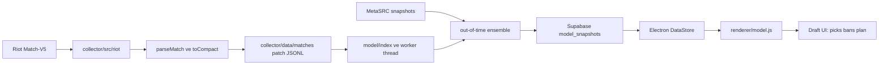

# Itachio Draft Sistemi: Teknik Referans

> Kapsam: Bu belge, champ-select sırasında şu anda çalışan Itachio modelini uçtan uca açıklar. `analytics/` altındaki ClickHouse/ONNX/item/CATE/MCP paketi ayrıca belgelenir; bu paket henüz Electron öneri motorunun yerine geçmez. Winrate.gg’nin üretim ağırlıkları veya özel feature listesi kamuya açık olmadığı için bu proje onun birebir model kopyası olduğunu iddia etmez.

## 1. Sistem Sınırı

Itachio’da iki ayrı model yolu vardır:

| Yol | Durum | Veri ve kullanım |
|---|---|---|
| Collector lojistik draft modeli | Aktif üretim yolu | Riot Flex ve Solo/Duo maçlarından yerel olarak eğitilir; model snapshot’ı Supabase’e gönderilir; Electron bu snapshot’la champ-select önerisi, ban, pick-order, game plan ve draft geçmişi skorlarını üretir. |
| MetaSRC draft verisi | Aktif dış kaynak ve cold-start prior’ı | Meta, synergy ve matchup tabloları sağlar. Collector bunları tarihli snapshot’larda saklar; desktop yeni model yokken bunları öneri fallback’i olarak kullanır ve düşük model confidence’ında ensemble’a katar. Build collector’ı MetaSRC build parçalarını da Riot maçlarının build istatistikleriyle harmanlar. |
| `analytics/` TypeScript paketi | Deneysel, üretim desktop’ına bağlı değil | 58 boyutlu Itachio feature vektörü, ClickHouse ingest/queries, Node logistic → ONNX, pairwise item scorer ve cross-fitted causal estimator içerir. Örnekleri henüz current desktop modelinin yerini alacak kaliteye ulaşmadı. |

Aktif veri yolu:



## 2. Veri Toplama ve Normalizasyon

### Riot kaynakları

Collector’ın ana girişi [collector/src/run.js](../collector/src/run.js), seçili kaynağı `COLLECTOR_SOURCE` üzerinden yükler. Riot kaynağı [collector/src/sources/riot.js](../collector/src/sources/riot.js) ve [collector/src/riot/crawl.js](../collector/src/riot/crawl.js) üzerinden çalışır. Mevcut ürün Solo/Duo (`420`) ve Flex (`440`) maçlarını kullanır; crawler Flex’i önce toplar, sonra Solo/Duo ile genişletir. Region routing Riot’ın AMERICAS, EUROPE, ASIA ve SEA gruplarına göre yapılır. Geliştirme API anahtarı 24 saatte sona erebildiğinden key hatasında toplanan veriyi kaydedip durur.

[collector/src/riot/parse.js](../collector/src/riot/parse.js) şu verileri ayıklar:

- queue, patch, match ID, başlangıç zamanı ve süre;
- her tarafın beş rolündeki champion ID ve galibiyet etiketi;
- team bans;
- Match-V5 `challenges` alanlarından 10. dakika minion/jungle CS, lane gold/XP avantajı ve ilgili erken oyun ölçümleri;
- rune, summoner spell ve oyun sonu item’ları;
- Match-V5 hasar, iyileştirme ve CC ölçümleri;
- participant ID’ler, timeline isteğini sonradan eşleştirmek için.

Kuyruk dışı oyunlar, remakeler, eksik katılımcılar ve rol başına tek champion şartını karşılamayan maçlar analiz için elenir. Kaynak API şekilleri ve limitleri Riot’ın [Match-V5](https://developer.riotgames.com/apis#match-v5) dokümantasyonundadır.

### Compact maç kaydı

[collector/src/model/features.js](../collector/src/model/features.js) `toCompact()` ile tek maçları küçük JSON satırlarına dönüştürür. Tipik kayıt şekli:

```json
{
  "id": "EUW1_123",
  "q": 440,
  "w": 1,
  "b": [1, 2, 3, 4, 5],
  "r": [6, 7, 8, 9, 10],
  "patch": "16.21",
  "x": [11, 12],
  "lb": [[0, 0, 0, 0, 0, 0, 0], null, null, null, null],
  "gb": [[8008, 9111], null, null, null, null],
  "xb": [[12000, 8000, 3000, 16], null, null, null, null]
}
```

`b` ve `r` sırası `top, jungle, middle, bottom, utility`; `w=1`, blue tarafın kazandığını ifade eder. Kayıtlar `collector/data/matches/<patch>.jsonl` içine yazılır ve match ID ile deduplicate edilir. Bu yerel match dosyaları Supabase’e gönderilmez; production veritabanına öğrenilmiş snapshot gider.

Başlangıç item’ı ve purchase order için collector, `ib/ir` participant ID’leri bulunan maçların bir alt kümesine ayrı Riot timeline isteği yapar. [collector/src/riot/timelines.js](../collector/src/riot/timelines.js), ilk dakikadaki satın alımları ve sonraki satın alım sırasını saklar. Bu, tam maç timeline arşivi değildir.

## 3. Aktif Draft Modelinin Feature’ları

Aktif modelin feature üreticisi [collector/src/model/features.js](../collector/src/model/features.js) içindedir. Her maç blue tarafından işaretlenmiş sparse feature satırına çevrilir:

| Feature grubu | Anahtar biçimi | Anlam |
|---|---|---|
| Champion strength | `c:<champion>:<role>` | Champion’ın belirli roldeki temel galibiyet etkisi. |
| Off-role | `o:<role>` | Champion’ın seçildiği roldeki oyun payının `-ln(share)` etkisi; katsayı non-positive olacak şekilde kısıtlanır. |
| Champion synergy | `s:<a>:<roleA>:<b>:<roleB>` | Aynı takımda iki champion-role çifti. Canonical sıra kullanılır. |
| Class synergy | `ts:<classA>:<classB>` | Data Dragon primary class’ları arasındaki aynı takım ilişkisi; görülmemiş champion çiftlerine zayıf prior sağlar. |
| Champion matchup | `v:<a>:<roleA>:<b>:<roleB>` | Bir champion-role çiftinin karşı champion-role’a etkisi. Ters matchup aynı katsayının negatifidir. |
| Class matchup | `tv:<classA>:<classB>` | Class’lar arası antisymmetric matchup. |
| Composition pillars | `a:<pillar>` | Damage imbalance, frontline, control, high-damage/low-control ve frontline/marksman etkileşimleri. Data Dragon class tag’lerinden türetilir; gerçek hasar/CC ölçümü değildir. |
| Erken oyun | `e:c`, `e:s`, `e:v` | `early.js` tarafından draft’tan tahmin edilen lane/objective avantajının win modeline eklenen strength, synergy ve matchup bileşenleri. |

Blue takım feature’ları pozitif, red takım feature’ları negatif yönde eklenir. Label, blue galibiyetidir. Match başına champion, role ve takım kompozisyonu feature’ları bu nedenle tek bir blue-vs-red lojistik örneği oluşturur.

### Erken oyun katmanı

[collector/src/model/early.js](../collector/src/model/early.js), yalnızca sonuçtan daha az gürültülü erken sinyalleri kullanır. Önce lane erken durumundan ve ilk objective sonuçlarından bir early-state win logit’i öğrenir. Sonra bu fiyatlanmış erken avantajı draft strength ve pair feature’larından tahmin eder. Cross-fitting sayesinde bir maçın erken feature’ı, o maçın sonucu ile eğitilmiş katsayıdan gelmez. En az 3.000 erken oyun verili maç olmadan bu katman eklenmez.

Turret plate, solo kill ve oyun sonu sayıları erken oyun target’ına katılmaz; bunlar maç boyunca oluşur ve sonuçla karışır. Erken katman zayıfsa held-out gain eşiğini geçmeyebilir; exported `early.kept` bunu belirtir.

### Composition katmanı

[collector/src/model/comp.js](../collector/src/model/comp.js), her champion için dört öğrenilmiş latent style değeri oluşturur. Takım stili champion vektörlerinin toplamıdır. Nonlinear doygunluk terimi aynı stilin beş champion’da da sınırsız büyümesini önler; antisymmetric `M` matrisi iki takım stili arasındaki etkileşimi modeller. Katman, diğer modelin calibrated out-of-fold tahminlerinin üzerine fit edilir ve sıfır etki/no-composition seçeneği dahil validation ile karşılaştırılır.

## 4. Aktif Trainer ve Model Export’u

Trainer [collector/src/model/train.js](../collector/src/model/train.js), feature’ları CSR sparse matriste saklar. Model bir binary logistic regression’dır:

```text
z = bias + Σ(feature_i × weight_i)
p(blue wins) = sigmoid(z)
```

Eğitim ve seçim akışı:

1. Güç katmanı `c/o` ile başlar.
2. Erken oyun varsa `e` katmanı eklenir.
3. Champion/class synergy, champion/class matchup, composition pillars, factorization-machine latent pairs sırayla denenir.
4. Her katmanda tau (pseudo-game regularization) grid’i iki validation split üzerinde denenir. Pair katmanları ayrıca adaptive shrinkage dener.
5. Beş fold out-of-fold tahminleri ile katmanın önceki modele göre logloss gain’i ve paired standard error hesaplanır. “Proven” kriteri `gain > 2 × SE`’dir; katmanlar modelden atılmayabilir ama raporlanır.
6. OOF tahminlerine Platt scaling uygulanır, final katsayılar all-match fit’ten ve yaklaşık diagonal Laplace standard error’larından çıkarılır.

Varsayılan trainer ayarları: 5 fold, latent boyut 6, tuning 200 iteration, final fit 500 iteration; tuning satır sınırı 60.000, final fit örnekleme sınırı 250.000. Bu sınırlar CV’nin tüm retained örnekleri değerlendirmesini engellemez; yalnızca fit belleğini sınırlar. Kaynak kodu ve feature girişleri [collector/src/model/train.js](../collector/src/model/train.js) içinde.

[collector/src/model/index.js](../collector/src/model/index.js) varsayılan 300.000, maksimum 1.000.000 match tutar (`MODEL_MAX_TRAIN_MATCHES`). Current patch maçları önce kullanılır; `model-state.json` içinde proven model için gereken eşik bilinmiyorsa 60.000 kabul edilir. Gerekirse daha eski patch’ler ağırlıkları düşürülerek bu eşiği tamamlar. Eğitim worker thread’inde yürür; scheduled collector oyun/GPU yükünde bekleyebilir veya durdurulabilir.

`exportModel()` snapshot’ın önemli alanlarını oluşturur:

| Alan | İçerik |
|---|---|
| `champ` | `champion:role → [weight, games, share, standardError]` |
| `off` | Her rolün off-role katsayısı. |
| `syn`, `vs`, `ts`, `tv` | Öğrenilmiş champion/class pair ağırlıkları. |
| `synE`, `vsE`, `early` | Early game layer ve lane/objective summary. |
| `fm` | Latent `S/P/Q` vektörleri; az verili champion-role çiftleri dışarıda bırakılır. |
| `comp`, `pillars`, `tags` | Öğrenilmiş composition ve class proxy’leri. |
| `banRate`, `counterpick` | Ban frekansları ve real pick’lerden öğrenilen counterpick `lambda`. |
| `center`, `pointsPerLogit`, `shareFloor` | Desktop’un sabit 0–100 sunum ölçeği parametreleri. |
| `ensemble` | MetaSRC ile out-of-time calibration/weight seçimi. |
| `patchMatches`, `patchStartedAt` | Aktif patch’teki yerel training corpus sayısı ve patch başlangıç zamanı; adaptive blend için kullanılır. |
| `blindability` | Bu Itachio işinde eklenen odds-adjusted blind spread/counter-pool hesabı. |

Snapshot [Supabase model_snapshots](../supabase/migrations/0007_model_snapshots.sql) tablosunda tek JSON document olarak saklanır; son üç snapshot tutulur. Model tek başına fit edildiği collector bilgisayarında kalır; raw matches sunucuya yüklenmez.

## 5. MetaSRC: Cold Start ve Ensemble

MetaSRC kaldırılmadı. [collector/src/sources/metasrc.js](../collector/src/sources/metasrc.js) ve `metasrc-builds.js` ayrı scheduled kaynak olarak yaşamaya devam eder. Üç ayrı rolü vardır:

1. Model snapshot’ı yokken legacy recommendation engine’e ilk champion/meta, synergy ve matchup verisini sağlamak.
2. Riot modelinin az verili olduğu dönemde draft tahminini confidence-weighted olarak desteklemek.
3. Runes, spells, start/core item ve item path seçimlerini Riot maçlarının build frekanslarıyla birleştirmek.

Desktop’ta `metaFallbackStats()` sadece `source='metasrc'` satırlarını seçer. Model yoksa eski scorer doğrudan fallback olur. Model varsa `modelConfidence()` şu bileşenleri kullanır:

```text
strengthConfidence = matches / 20,000 (0.2–1 aralığı; veri yoksa 0.5)
synergyConfidence  = min(1, learnedSynergyCount / 200)
matchupConfidence  = min(1, learnedMatchupCount / 200)
confidence         = 0.4 × strength + 0.3 × synergy + 0.3 × matchup
```

Patch-aware fallback, ilk 48 saatte `%20 model / %80 MetaSRC` hedefiyle başlar. Sonrasında hedef model payı aktif patch maç sayısıyla doğrusal biçimde artar: `0.20 + 0.60 × min(patchMatches / 10,000, 1)`. 10.000 maçta hedef `%80 model / %20 MetaSRC` olur. Bu hedef ayrıca `modelConfidence` ile çarpılır; desteklenmiş OOT backtest weight’i hedefi aşamaz. Snapshot önceki patch’e aitse o patch’in maç sayısı kullanılmaz ve yeni patch saati esas alınır. Patch başlangıç saati `current_patch` metadata’sından gelir; Data Dragon sync aynı patch değerinde timestamp’i yenilemez.

[collector/src/run.js](../collector/src/run.js), MetaSRC’nin 50’den az normalize edilmiş meta satırı döndürmesini başarısız `collector_runs` olarak yazar; scraper hataları da `error` olur ve son iyi tablolar korunur. Desktop son başarılı, boş olmayan MetaSRC koşusunu izler; 72 saat boyunca başarılı snapshot yoksa üst barda uyarı gösterir ve health’i her 10 dakikada yeniler.

[Migration 0016](../supabase/migrations/0016_ensemble_backtest.sql) tarihli `meta_source_snapshots` ve `ensemble_observations` tablolarını oluşturur. Collector yalnızca hem model snapshot’ı hem aynı patch MetaSRC snapshot’ı maçtan önceyse observation üretir. En az 500 observation olduğunda en eski %50 ile MetaSRC kalibrasyonu fit edilir; sonraki %20’de `0.00…0.80` arası 0.05 adımlı model weight denenir; en yeni %30, 50/50 baseline’a göre doğrulanır. Candidate ancak validation gain’i `2 × SE`’yi aşarsa seçilir. Yeterli OOT evidence var ama seçim desteklenmiyorsa model payı `%50` ile sınırlı kalır; 500 observation altındaysa patch-count/confidence schedule kullanılır.

Desktop desteklenen kalibrasyonda `MetaSRC` meta/synergy/matchup feature’larını logit’e dönüştürür ve model logit’iyle birleştirir. Kalibrasyon yoksa 0–100 skorlar confidence ve patch weight’iyle harmanlanır. Böylece MetaSRC cold-start prior’ı kalır; stale kaynak uyarısı veri güncelliğini bildirir, var olmayan yeni snapshot üretmez.

## 6. Desktop Draft Inference

Modelin Supabase’den okunması [desktop/src/main/data.js](../desktop/src/main/data.js) içindeki `loadModel()` ile yapılır. [desktop/src/main/core.js](../desktop/src/main/core.js) yeni snapshot’ları draft’lar arasında kontrol eder; yeni snapshot champ-select başlarken bir kez alınır ve draft ortasında değiştirilmez. Aynı lobby’deki puanlar aynı model sürümünü kullanır.

[desktop/src/renderer/model.js](../desktop/src/renderer/model.js) exported snapshot’ı cache’lenmiş index’lere çevirir:

- Champion strength ve role share;
- explicit + early synergy/matchup ağırlıkları;
- latent factor `dot(Sa,Sb)` synergy ve `dot(Pa,Qb)-dot(Pb,Qa)` matchup;
- class pair’leri, composition, pillars, early lane/objective verisi;
- role share üzerinden bilinmeyen düşman lane’leri için role assignment olasılıkları;
- matchup seçimindeki `counterpick.lambda`.

Bir candidate için aktif scoring adımları:

```text
baseLogit = championRoleWeight
          + offRoleWeight × -ln(roleShare)
          - modelCenter
          - uncertaintyPenalty

boardLogit = baseLogit + synergy + matchup + composition - lanePenalty
score = 50 + 50 × tanh(0.35 × boardLogit / roleStrengthSD)
```

`score` bir model sıralama puanıdır; otomatik olarak doğrudan “takımın gerçek maç kazanma olasılığı” diye yorumlanmamalıdır. Final 10 champion draft tahmini ayrı `winChance`/`winParts` fonksiyonundan gelir. `recommend()` board etkilerini aynı roldeki popularity-weighted typical pick’e göre merkezler; bu sayede draft’taki bütün ally bonusları herkesi topluca yukarı çekmez.

`scoreOne()` ayrıca `base`, `synergy`, `matchup`, `composition`, `lane`, `games`, `pickRate`, `uncertainty`, ally/enemy hit listelerini döndürür. Kısıtlı veri `unsure` olarak işaretlenir; role’de görülmemiş veya takımların %1’inden azının seçtiği champion öneri listesine alınmaz, fakat hover/evaluate edilebilir.

### Bilinmeyen rol ve Flex champion’lar

Ranked champ-select düşman role bilgisini saklayabilir. `roleAssignments()` her champion’ın gözlenen role share’lerine göre olası beşli atamalar üretir; aynı takımda aynı role iki champion koymaz. Karsi takımın matchup ve synergy ağırlıkları olasılık üzerinden beklenen değere çevrilir. Bu, tek tek en popüler rolü seçip bütün Flex champion’ları aynı role yerleştirmekten kaçınır.

### Look-ahead ve counter ayrımı

- `counterRisk`: Bu draft sırasından sonra rakibin seçebileceği champion’ların candidate’a beklenen logit maliyeti. Rakibin açık role’leri, pick popularity’si ve `lambda` ile ağırlanır; hangi enemy pick’in candidate’tan sonra gelebileceği `answerShare` ile sınırlanır. UI’de draft bazlı, güncel ve değişken risktir.
- `blindability`: Collector’ın tüm maçlardan hesapladığı genel lane spread’idir. Matchup win rate’i champion’ların kendi global odds beklentisinden çıkarılır; eşleşme örneklem noise’u azaltılır; role pick rate ve ban oranı ağırlıklarıyla hard-counter oranı ve yedi kişilik pool olasılığı hesaplanır. Bu kişisel rakip champion pool’u değildir.

Bunlar ayrı kavramlardır; UI/model alanları da ayrı kalmalıdır.

### Trait heuristiği: takım kompozisyonu ve ikili sinerji

Öğrenilen model yalnızca kazandı/kaybetti etiketini görür; held-out gain’leri çok küçüktür (synergy katmanı yalnız ~3.7 bin çift ağırlığıyla `gain ≈ 3e-4`, composition pillars kanıtsız) ve AP/AD dengesi, CC, frontline veya duo gibi kuralları öğrenemez. Bu yüzden [desktop/src/renderer/traits.js](../desktop/src/renderer/traits.js) elle puanlanmış bir heuristik katman ekler; çıktıları modelin strength spread’i (`ix.sd`) cinsinden olduğu için öğrenilmiş logit’lerle toplanabilir. `heuristics: false` snapshot alanı (testler) katmanı kapatır.

- **Trait tablosu**: Her champion 0-3 ölçeğinde `fr` frontline, `cc`, `en` engage, `pk` poke/menzil, `pe` peel, `ac` area control, `wc` waveclear, `sc` scaling, `pi` pick/burst, `sp` split push ve `mg` (magic hasar payı, 0-10) ile puanlanır. Data Dragon’da olmayan/yeni champion’lar primary class’tan türetilen profile düşer.
- **Hasar dengesi**: Takımın magic payı, tank’ların hasarını azaltan ağırlıkla (`1 - 0.15·fr`) hesaplanır. `[0.22, 0.78]` bandı dışı ceza `1.2·(d/0.1)^1.5` sd’dir. Açık slotlar uç değerle (0.9/0.1) doldurulursa bile bant düzelmiyorsa tam ceza; düzeliyorsa yalnız hafif baskı (`0.4·(d/0.1)^1.2`) vardır. Böylece beş AD/AP takım oluşmaz, eksik kalan hasar tipi önerilerde öne çıkar.
- **İhtiyaçlar**: Takım picklerinin eğilimi (`pk/en/pe/pi/sp` toplamlarının ortalamaya oranı) bir plan seçer: poke, engage/front-to-back, protect-the-carry, pick/dive veya split. Planın tam takım için gereken toplamları (frontline, CC, engage, waveclear, AoE ve plana özel poke/peel/pick/split) pick sayısıyla `trust = min(1, (n-1)/3)` kadar karışır. Kalan slotlar ortalama champion sayılır; `short = max(0, floor - projected)/floor` ve ceza `w·short^1.5`’tir (CC 2.0, frontline 1.8, poke 1.5 en ağır). Kimse mükemmel olmak zorunda değildir: bir joker eksik kalabilir, ceza yumuşaktır.
- **Koordinasyon**: `n ≥ 3` için baskın eğilimin payı `0.34`’ün altına düşerse (poke + engage + pick karışımı) `((0.34 - pay)/0.1)^2` ceza gelir.
- **Duo prior’ı**: `synergy()` her çifte `ix.sd × pairBonus` ekler: elle seçilmiş ~85 duo (ADC-support, Yasuo-knock-up, Orianna-engage vb.; ağırlık 1-3 × 0.1 sd) ve trait’ten türeyen en çok 0.15 sd (engage + AoE takip, peel + scaling carry, iki poke, iki pick). Bu prior look-ahead, role-assignment ve typical-pick normalizasyonundan geçtiği için aynı rolde ortalama pick’e göre fark yaratır.
- **Entegrasyon**: `scoreOne` takım cezasını candidate + mevcut ally’lerle `composition` parçasına ekler; `winParts` iki takımın cezasını farkıyla composition’a katar. Heuristik, kalibre öğrenilmiş olasılığın yerine geçmez; elle ayarlıdır ve [desktop/test/traits.test.js](../desktop/test/traits.test.js) ile korunur.

### Bans, pick order ve game plan

- Ban değeri, rakibin açık role’lerinde champion pick olasılığı × rakibin locked ally’lerine karşı logit avantajı toplamıdır. Ban rate pick paydasına uygulanır. Bir teammate champion göstermediyse, bu patch’te kendi rolünde en çok oynadığı champion ban hesabında niyet prior’ı olur.
- Pick order counter-risk’i, lane görünürlüğünü, jungle/bot gereksinimini ve solo lane’in kişisel havuz derinliğini kullanır. Rakibin ilgili role’ü görünüyorsa (rol olasılığı `roleAssignments` ile) counter bonusu baskındır (`30 + matchup`, jungle `22 + min(6, matchup)`; blind safety `roleBias` 0-10 puandır) ve biz o role’ü görünen rakipten hemen sonra alırız; rakip görünmüyorsa risk ve `roleBias` belirler. Öneri 1.5 saniye sabit kalmadan uygulanmaz; küçük farklar hysteresis ile tutulur; eşzamanlı ally pick’leri arasında trade gösterilmez.
- Game Plan full draft için champion strength/off-role, synergy, matchup ve composition parçalarını; early/later edge, five lane matchup ve objective avantajını aynı logit modelinden türetir. Panel strateji tavsiyesi metni yerine kazanma şansı, istatistikler ve görsel göstergeleri sunar.

UI akışı [desktop/src/renderer/app.js](../desktop/src/renderer/app.js) ve [desktop/src/renderer/champselect.js](../desktop/src/main/champselect.js) tarafında; client’a sadece kullanıcı tıklaması/ayar açık olduğunda hover veya rune/build apply gider, Itachio lock-in yapmaz.

## 7. Kişiselleştirme

[collector/src/players/history.js](../collector/src/players/history.js), takım üyelerinin Riot ID’si ile Solo/Duo ve Flex ranked geçmişini toplar. [collector/src/players/analyze.js](../collector/src/players/analyze.js) üç ayrı kaynağı üretir:

- `season`: sezonun bütün ranked maçları;
- `history`: yalnızca current patch;
- `team`: oyuncunun tarafındaki beş kişinin hepsi Itachio takımı üyesi olduğunda, her ayrı lineup için.

Her maç oyuncunun erken lane sonucu ve draft’ın beklenen sonucuna göre late residual’a ayrılır; her champion değeri oyuncunun kendi ortalamasına göre shrink edilir. Erken shrinkage yaklaşık 10–50 pseudo-game, late residual yaklaşık 200 game prior kullanır; familiarity ilk champion oyunlarından pooled çıkarılır. Mastery, champion maçlarının prior etkisini gevşetir ama başarıyı kendi başına icat etmez.

Renderer’da `personalFor()` season ve patch değerlerini her zaman, team değerini yalnızca aynı beşli lineup ile kullanır. Champion/class prior, az oynanan veya oynanmamış champion’lara kişisel sinyal aktarır. Kişisel logit katkısı `PERSONAL_WEIGHT=0.5` ile uygulanır, `PERSONAL_CAP=0.4 SD` ile sınırlanır. Veriler `player_champion_stats` ve History için `player_games` tablosundadır.

### Lobby/queue rol dağılımı

Lobby veya queue’dayken (`/lol-lobby/v2/lobby`, gameflow `Lobby/Matchmaking/ReadyCheck`) beş kişinin de team üyesi olduğu tespit edilirse (`puuid` eşleşmesi), `Engine.lineupRoles` kimin hangi rolde oynaması gerektiğini önerir ve Draft sekmesinin bekleme ekranında gösterir. Her oyuncu × rol hücresi şu kaynaklardan hesaplanır: season, patch (`history`) ve tam bu beş kişiyle oynanan `team` istatistikleri (ağırlıklar 1 / 0.8 / 1.6; kaynaklar yoksa ağırlıktan çıkar). Her kaynakta rol için oynanan champion’ların oyun ağırlıklı `delta` ortalaması `games + 15` ile shrink edilir; role’ün toplam oyun içindeki payı (`ROLE_EXPERIENCE` 0.4 sd), pool derinliği (`poolDepth`, 0.3 sd) ve hiç oynanmamış rol cezası (0.5 sd) eklenir. Team sekmesinde seçilen roller ±0.3 sd, lobby position tercihi +0.15 sd ekler. 120 rol permütasyonunun toplamı sıralanır; en iyi üç seçenek, aradaki fark (`margin < 3` “close call”) ve her oyuncunun en çok oynadığı champion’lar gösterilir. Puanlar modelin sd ölçeğindedir.

## 8. Builds ve Mevcut Item Mantığı

Production build sistemi, deneysel pairwise scorer değildir. [collector/src/model/builds.js](../collector/src/model/builds.js) champion-role-damage bucket’larında rune/spell/item seçimlerini Riot maçlarından toplar; timeline verisi olan maçlardan start item ve purchase order öğrenir. Düşman magic damage profili, enemy damage bucket’ını `any/ap/ad/mixed` eşikleriyle seçer. MetaSRC builds, eldeki Riot build evidence’ı ile harmanlanır; `modelWeight` arttıkça dış build prior’ı azalır.

Situational item’lar `app_meta.item_situations` içinde tutulur. Collector champion’ın magic damage share, healing/min, CC/min ve assassin profile’ını oluşturur; item satın alanların game outcome residual’ına ridge regresyon uygular. Ağırlık 1 percentage point win-chance değerini aşmıyorsa ilgili gerekçe atılır. Bu nedenle “vs healing”, “vs magic damage” gibi reason’lar birinci elden maç feature’larından gelir.

## 9. Meta’dan Ayrı Analytics Paketi

`analytics/` deneysel TypeScript paketidir ve mevcut Electron scorer’a bağlanmaz. Kaynak dosyaları [analytics/src](../analytics/src/), testleri [analytics/test](../analytics/test/) içindedir. Bu paket Winrate.gg private feature set’i veya modeli değildir.

### 58-feature draft vector

ClickHouse row metadata’sı `champion_id`, `team_side`, `lane_id`, `patch`, `queue_id`, `rank_tier` ve `won`; `features` sabit sıralı 58 `Float32` değerdir. Metadata içindeki üçlü `damage_profile` AP/AD/true oranlarını, `cc_score` champion profilinin maç başı CC ortalamasını tutar.

| Index | Feature | Kaynak/yorum |
|---:|---|---|
| 0 | `candidate_win_rate` | Champion-role smoothing’li prior win rate. |
| 1 | `candidate_patch_win_rate` | Mevcut prior penceresindeki win rate; input history aynı patch olmalıdır. |
| 2 | `candidate_lane_win_rate` | Champion-role prior’ı; özel lane history yoksa bu değere geri düşer. |
| 3 | `candidate_role_share` | Champion’ın tüm role oyunları içinde bu lane payı. |
| 4 | `candidate_pick_rate` | Role popülaritesi. |
| 5 | `candidate_ban_rate` | Önceki maçlardan ban payı. |
| 6 | `candidate_sample_confidence` | `games / (games + 100)`. |
| 7 | `candidate_uncertainty` | Sample uncertainty prior’ı. |
| 8 | `candidate_blind_spread` | Collector blindability değeri mevcutsa. |
| 9 | `candidate_counter_rate` | Pick-rate ağırlıklı lane-counter oranı. |
| 10 | `candidate_counter_chance` | Yedi champion pool tahmini. |
| 11 | `candidate_scaling` | 30 dakika+ win rate minus tüm süre win rate. |
| 12–14 | `candidate_damage_ap/ad/true` | Champion hasar oranları. |
| 15 | `candidate_cc` | CC duration profile. |
| 16–19 | `candidate_frontline/sustain/range/engage` | Match V5-derived proxy; range şu anda neutral `0.5`, engage CC proxy’si. |
| 20 | `matchup_win_rate` | Adayın açık düşman lane’lerine karşı smoothed historical win rate ortalaması. |
| 21 | `matchup_coverage` | Karşılaşma prior’ı bulunan düşman payı. |
| 22 | `matchup_sample_confidence` | Matchup pair sample confidence. |
| 23 | `synergy_average` | Ally’lere karşı ortalama pair effect. |
| 24–25 | `synergy_best/worst` | Gözlenen en iyi/en kötü pair effect. |
| 26 | `synergy_coverage` | Synergy prior’ı bulunan ally payı. |
| 27 | `synergy_sample_confidence` | Synergy pair sample confidence. |
| 28–30 | `ally_damage_ap/ad/true` | Aday dahil kendi takımının hasar payları. |
| 31 | `ally_damage_imbalance` | AP–AD mutlak farkı. |
| 32–34 | `enemy_damage_ap/ad/true` | Rakip takım hasar payları. |
| 35 | `enemy_damage_imbalance` | Rakibin AP–AD farkı. |
| 36–38 | `damage_ap/ad/true_delta` | Kendi takım hasar payı minus rakip. |
| 39–41 | `ally_cc`, `enemy_cc`, `cc_delta` | Takım profili ortalama CC ve farkı. |
| 42–44 | `ally_frontline`, `enemy_frontline`, `frontline_delta` | Damage taken/dealt proxy’si ve farkı. |
| 45–47 | `ally_sustain`, `enemy_sustain`, `sustain_delta` | Ortalama healing proxy’si ve farkı. |
| 48–50 | `ally_scaling`, `enemy_scaling`, `scaling_delta` | 30 dakika sonrası win-rate residual’ı ve farkı. |
| 51–52 | `ally_pick_count`, `enemy_pick_count` | Takım başına mevcut pick sayısı, 0–1 ölçeği. |
| 53 | `net_ban_count` | Ally ban sayısı minus enemy ban sayısı. |
| 54 | `pick_order` | Geçmiş Match-V5’te seçim sırası yok; eğitimde neutral 0. |
| 55 | `enemy_answer_share` | Geçmişte seçim sırası yok; eğitimde 1 (tüm answer’lar mümkün). |
| 56 | `patch_age` | Tek patch eğitiminde 0. |
| 57 | `rank_tier` | Iron–Diamond 0–6; Master+ 6. Unknown için numeric neutral 3 ve metadata `UNKNOWN`. |

> Feature order `DRAFT_FEATURE_NAMES`’te sabitlenmiştir. Model artifact’leri bu order/versiyonla birlikte taşınmalıdır; index reorder’ı backward-incompatible değişikliktir. Şu an `version=1` ve `featureCount=58` doğrulanır.

### ClickHouse tablo ve ingestion

[analytics/sql/001_init.sql](../analytics/sql/001_init.sql) iki MergeTree tablosu oluşturur:

- `itachio.matches`: patch, queue, region, rank tier, timestamp, outcome, bans ve PUUID’siz `participants_json`.
- `itachio.draft_observations`: champion-role başına 58 feature array’i, `damage_profile` tuple’ı ve label.

[analytics/src/ingest-cli.ts](../analytics/src/ingest-cli.ts) mevcut compact JSONL’ı batch’lerle ClickHouse’a yazar. `16.21.jsonl` gibi patch-scoped dosya adı, sadece satırda bulunmayan aynı patch’i tamamlamak için kullanılabilir; başka eksik alanlar uydurulmaz. Historical rank map verilmezse `rank_tier='UNKNOWN'` kalır; rank-standardized matchup query’leri bu satırları dışlar. `RiotMatchV5` tipleri resmi Match-V5’teki queue/version/participants/teams alanlarına göre daraltılmıştır; tüm Riot DTO’nun kopyası değildir.

```powershell
npm run ingest --prefix analytics -- ../collector/data/matches/16.21.jsonl [rank-tier-map.json]
```

Gerekli env ayarları [analytics/.env.example](../analytics/.env.example) içindedir. Match ingest için gerçek `CLICKHOUSE_URL`/credentials gerekir; bu workspace’te ClickHouse server yapılandırılmadı ve canlı insert yapılmadı.

### Deneysel Node trainer ve ONNX

[analytics/src/training-data.ts](../analytics/src/training-data.ts), maçları zaman sırasına dizer; ilk %70 ile champion, lane, pair, damage/heal/CC prior’larını hesaplar; sonraki pencerenin en fazla `DRAFT_TRAIN_MATCHES` maçını 10 champion-role observation’a çevirir. Eğitim/validation ayrımı `match_id` bazında yapılır; aynı maçın participant satırları iki tarafa bölünmez.

[analytics/src/training.ts](../analytics/src/training.ts) 58-feature standardized logistic regression’ı Node’da eğitir, 80/20 match-level holdout logloss/accuracy üretir ve protobuf ile `MatMul → Add → Sigmoid` ONNX graph yazar. Bu XGBoost veya LambdaMART değildir. [analytics/src/predictor.ts](../analytics/src/predictor.ts) `onnxruntime-node` session açar ve 58-float tensor ile olasılık üretir.

Feature attribution için ONNX Runtime gradient API’si olmadığından `DraftPredictor.explain()` sonlu farkla yaklaşık Integrated Gradients hesaplar: champion win-rate özelliklerinin baseline’ı 0.5, diğerlerinin 0; path 10 aralıklı trapezoid integrali, gradient için `epsilon=0.001`. Bu yöntem TreeSHAP değildir ve doğruluk/kalibrasyon sonucu değildir; yalnızca model sensitivity açıklamasıdır. Model current champion listesi üretmez; caller her aday için DraftStateVector hazırlayıp `recommend()`’e verir.

Training komutu:

```powershell
npm run train --prefix analytics -- ../collector/data/matches/16.21.jsonl
```

Son gerçek corpus denemesi 182.925 satırdan 500.000 champion-role observation üretti. 50.000 sonraki maç / 80 epoch ayarında validation: **51.94% accuracy, 0.6920 logloss**. Bu aynı split’teki mevcut production model ile ölçülmedi ve replacement için yeterli değil; `analytics/models/` altındaki artifact gitignore edilir. Electron model yüklemesi hâlâ Supabase’in mevcut model snapshot’ından yapılır.

### Deneysel pairwise item scorer

[analytics/src/items.ts](../analytics/src/items.ts) 20 item özelliğiyle pairwise logistic preference loss optimize eder: gözlenen `preferred` item utility’si `rejected` item’dan yüksek olmalıdır. Item feature’ları cost/gold, AD/AP/penetration, armor/MR/health, haste/attack speed/heal, enemy armor/MR’a göre etkin physical/magic power ve burst/DPS/tank kit interaction’larını içerir. Runtime `rank(currentGold, gameTime, enemyArmorSum, enemyMRSum, championKitType)` yalnızca gold ile alınabilen item’ları skorlayıp sıralar.

Bu bir lightweight pairwise modeldir, **LambdaMART değildir**. Şu anda mevcut purchase-order verilerinden item preference training pair’lerini çıkartan production job yoktur; unit tests sentetik tercih çiftleriyle scorer davranışını test eder. Electron’daki aktif build/situational item kaynağı hâlâ `collector/src/model/builds.js` ve MetaSRC build prior’ıdır.

### Deneysel causal insight

[analytics/src/causal.ts](../analytics/src/causal.ts) control ward’ı minute 5 öncesi treatment kabul eder. Pre-treatment confounders: gold/CS/level by minute 5, previous control-ward rate, champion prior win rate, rank, role ve patch age. Five-fold cross-fitting’le propensity logistic ve outcome linear nuisance modelleri öğrenilir; residualized treatment/outcome üzerinden R-learner effect ve approximate 95% normal interval hesaplanır. Minimum 100 total, 20 treated ve 20 untreated maç gerekir.

Minute-10 gold post-treatment outcome/mediator olabilir; bu yüzden model confounder olarak kullanmaz, yalnız descriptive average döndürür. LLM varsa sadece JSON-schema-constrained cümle üretir; `causal_delta` ve CI her zaman istatistiksel koddan gelir. Bu estimate gözlemsel veriye dayanır, treatment exchangeability/overlap varsayımları vardır, clustered/sandwich CI veya EconML DML implementasyonu değildir. Current Match-V5 collector control-ward timestamp ve 10-minute frame’leri saklamıyor; bu nedenle production summoner timeline ingest olmadan gerçek kullanıcı CATE insight’ı üretilemez.

### MCP `analyze_matchup`

[analytics/src/mcp.ts](../analytics/src/mcp.ts) güncel `@modelcontextprotocol/server` v2 ile `analyze_matchup(champion_a, champion_b, lane, patch?, queue_id?)` read-only tool’unu tanımlar. ClickHouse SQL parametre binding kullanır; aynı patch/queue/lane içindeki bilinen rank tier’ların gerçek dağılımını hesaplayıp tier win rate’lerini bu dağılımla standardize eder. `source` dışındaki tüm dynamic values parameter’dır.

[analytics/src/server.ts](../analytics/src/server.ts) Streamable HTTP endpoint’i `/mcp` üzerinde varsayılan loopback `127.0.0.1:8787`’ye açar. Node host/origin validator’ları kullanılır; non-loopback bind için minimum uzunluklu bearer token zorunludur. Stdio yerine HTTP kullanımı Winrate.gg’nin public MCP ürününe yöneliktir. MCP server bu workspace’te lokal test/compile edildi; production endpoint deploy edilmedi.

## 10. Çalıştırma ve Operasyon Komutları

```powershell
npm install --prefix analytics
npm run build --prefix analytics
npm test --prefix analytics
npm audit --prefix analytics --audit-level=high

# Mevcut compact maç corpus'undan model üret
npm run train --prefix analytics -- ../collector/data/matches/16.21.jsonl

# ClickHouse bağlantısı ayarlandıktan sonra raw + feature batch ingest
npm run ingest --prefix analytics -- ../collector/data/matches/16.21.jsonl

# MCP'yi local başlat
npm run serve:mcp --prefix analytics
```

## 11. Release Kararı ve Açık İşler

Draft scoring’de MetaSRC cold-start fallback ve collector’ın out-of-time kalibrasyonu korunur. Yeni ONNX modeli mevcut renderer’a bağlanmaz; önce aynı chronological, match-grouped holdout üzerinde production modelin logloss/accuracy değerini aşması gerekir. Mevcut run bunu başaramadı.

Model kalitesi korunur: trainer, feature seti, layer-proof (`gain > 2 × SE`) ve Platt kalibrasyonu bu sürümde değişmedi; yalnızca ensemble ağırlık ızgarası ve export alanları genişledi.

Release öncesi eksikler (analytics paketi için):

1. ClickHouse Cloud/self-hosted deployment ve secret provisioning.
2. Historical rank tier’ın maç zamanında kaynaklanması; bugünkü rank’i eski maça yazmak doğru değildir.
3. Match-V5 timeline frame/event ingest’i; control ward minute-5 treatment ve minute-10 feature’ları için migration/collector schedule gerekir.
4. Item bought-next comparisons çıkarımı, versioned ranker training ve yeterli gerçek holdout.
5. Yeni ONNX artifact’in Supabase snapshot/versioning ve Electron atomic model-load akışına bağlanması.
6. Production desktop data source, offline/fallback behavior, performance ve rollback testleri.
7. Candidate modelin production trainer’la aynı date/rank/queue/patch split’inde head-to-head backtest’i.

CI artık analytics compile/test/audit çalıştırır; mevcut Windows release workflow da analytics gate’ini çalıştırır. Bu, analytics server veya ClickHouse’ın production’a deploy edildiği anlamına gelmez. Bu belge desktop `v1.7.3` ile eşleşir (önceki tag `v1.7.2`). v1.7.0 ile gelen değişiklikler: adaptive patch-aware MetaSRC blend (model payı tavanı 0.80, OOT seçilmemişse 0.50 varsayılan), `blindability` export’u, `patchMatches`/`patchStartedAt` alanları, MetaSRC health izleme ve analytics CI/release gate’i. Doğrulama: collector 66, desktop 84, analytics 20 test geçti; `tsc --noEmit` temiz.

## 12. Referanslar

- Winrate public product: [Draft Assistant](https://winrate.gg/tools/draft), [Item Recommender](https://winrate.gg/tools/item-recommender), [SQL Console](https://winrate.gg/tools/sql), [MCP setup](https://winrate.gg/mcp).
- Official APIs: [Riot Match-V5](https://developer.riotgames.com/apis#match-v5), [MCP TypeScript v2 HTTP serving](https://ts.sdk.modelcontextprotocol.io/v2/serving/http), [ONNX Runtime Node](https://onnxruntime.ai/docs/get-started/with-javascript/node.html), [ClickHouse JS client](https://clickhouse.com/docs/integrations/javascript).
- Existing setup/model details: [Development guide](DEVELOPMENT.md).
